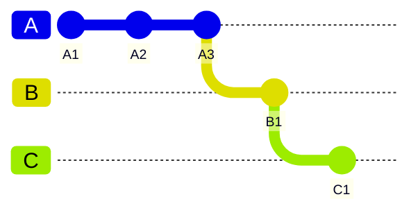
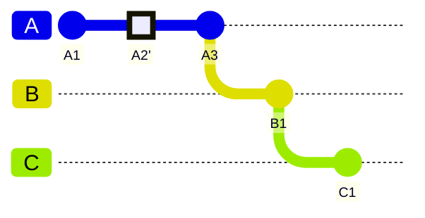
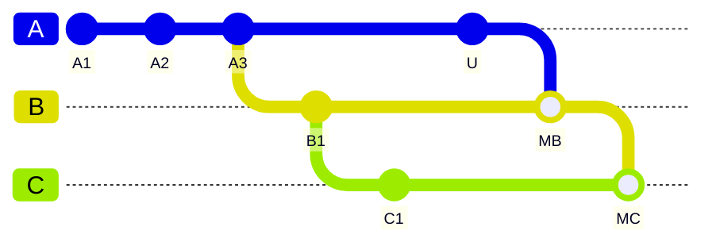

# jjack

`jjack` is a CLI and TypeScript library to help [jj](https://jj-vcs.github.io/jj/) users manage PR stacks on GitHub.

It started as a very stripped-down TS port of [@papertigers](https://github.com/papertigers)'s [`native-stacks` branch](https://github.com/papertigers/jj-spr/tree/native-stacks) of [`jj-spr`](https://github.com/jennings/jj-spr) (which in turn comes from [`spr`](https://github.com/getcord/spr)), but at this point it's fairly different in implementation. See [THIRD_PARTY_NOTICES.md](THIRD_PARTY_NOTICES.md) for attribution and licenses.

Because `jjack` is built narrowly around how I want to work, I don't expect anyone else to want to use it, but you might take it as inspiration when building your own stack tool. This repo is public mostly because my other public repo [`ah`](https://github.com/david-crespo/ah) depends on it for its stack management GUI, and I want anyone interested in that to be able to see all the pieces.

This was entirely vibe-coded with a variety of frontier models. I have not read any of the code and do not plan to. Despite that (or because of it), the tool and the GitHub test fake are pretty well-validated against actual GitHub behavior.

If you're looking for a stack tool to actually use yourself, you'll probably want one of these instead:

- jj-spr (original at [jennings/jj-spr](https://github.com/jennings/jj-spr), native stacks at [papertigers/jj-spr](https://github.com/papertigers/jj-spr/tree/native-stacks))
- [jj-ryu](https://github.com/dmmulroy/jj-ryu)
- [jj-stack](https://github.com/bos/jj-stack)

See [docs/comparison.md](docs/comparison.md) for details on how `jjack` differs from them.

## The problem with stacks on GitHub

A big problem for jj users trying to use stacks on GitHub is that if you do things naively, every time you change a PR lower in the stack, whether by editing a commit or adding a new one, later PRs get rebased and force pushed. This results in a very poor reviewing experience in GitHub because the reviewer cannot easily tell what changed between pushes. The `jj-spr` approach is to treat what gets pushed to GitHub as a sort of generated projection of the "real" change you have in jj locally, taking what is intuitive for you and turning it into something entirely different that displays well on GitHub. In practice what that means is merge commits.

## How `jjack` does it (which is also how `jj-spr` does it)

Say you have a stack of three PRs, A, B, and C, and the bottom one has three changes:



You make a change to A2 locally:



From git's point of view, everything from A2' on is brand new, so if you were to push the branches for A, B, and C directly, those are force pushes. What `jj spr diff` and `jjack submit` do here instead is maintain a second representation of the change that preserves all the existing commits, turning your change to A2 above into this:



`U` is an ordinary commit on top of A's branch that contains your edit. `MB` is a merge commit on B's branch with parents `B1` and `U`. `MC` is a merge commit on C's branch with parents `C1` and `MB`. Every commit that was already on GitHub is untouched, so each PR shows the update as new commits on top of what reviewers have already seen.

## This is Git and GitHub's fault

The only reason all this is necessary is that Git doesn't have a good canonical spot to put the information necessary to make this work well, and GitHub does not know how to display stacks and the changes between them properly. They're stuck in a very tough spot because the vast majority of their users are not using `jj`, but their most savvy users want functionality like this.

We want [interdiff](https://gist.github.com/thoughtpolice/9c45287550a56b2047c6311fbadebed2)!

## Install

Requires Node 24 or later, `jj`, and `git`. It also needs `gh` unless you pass `--token` or [set `jjack.token`](#configuration). From a checkout of this repository:

```sh
npm install && npm run build && npm install --global .
```

## Configuration

jjack reads jj config and falls back to the `jj-spr` keys, so a repository already set up for `jj-spr` works without changes.

| Key                     | Falls back to            | Default                                            |
| ----------------------- | ------------------------ | -------------------------------------------------- |
| `jjack.branchPrefix`    | `spr.branchPrefix`       | none (required; e.g., `yourname/`)                 |
| `jjack.repository`      | `spr.githubRepository`   | from the remote's URL (`owner/repo`)               |
| `jjack.remote`          | `spr.githubRemoteName`   | `origin`                                           |
| `jjack.mainBranch`      | `spr.githubMasterBranch` | the remote's bookmark at jj's `trunk()`, or `main` |
| `jjack.requireApproval` | `spr.requireApproval`    | `false`                                            |
| `jjack.token`           | `spr.githubAuthToken`    | the output of `gh auth token`                      |
| `jjack.apiUrl`          | `spr.githubApiUrl`       | `https://api.github.com`                           |

```sh
jj config set --repo jjack.branchPrefix yourname/
```

`--branch-prefix`, `--repository`, and `--token` override these for a single run.

## Describing a stack

`submit`, `land`, `sync`, and `close` take their PRs from one of two sources:

- **A stack file** (JSON) listing one entry per PR, from the bottom of the stack up. Each entry has a `tip` (a bookmark or change ID) and covers every change from the previous tip (or `main`) up to it. Set `title` directly, or set `body` to a markdown path relative to the stack file: a leading `# ` heading becomes the title (falling back to `title` if absent), and the rest becomes the PR body. Keep stack files outside the repo or in an ignored directory, since jjack updates them with PR metadata and jj snapshots unignored files.

  ```json
  {
    "prs": [
      { "tip": "routes", "body": "routes.md" },
      { "tip": "kxqzwmvtnlop", "title": "Document the handlers" }
    ]
  }
  ```

- **`-r <rev>`**, where each change from main up to `<rev>` becomes its own PR, titled with the first line of its description. jjack appends a `Pull Request: <url>` line to each change's description.

## Commands

- `jjack init <file> --tips <revset>` — write a stack file with one entry per tip, in stack order.
- `jjack status <file>` — check a stack file, showing what `submit` would do and any problems that would block it.
- `jjack adopt <file>` — take over open PRs pushed without jjack whose branch names match the entries' bookmarks.
- `jjack submit <file | -r rev>` — open or update PRs and register them through GitHub's native stacks API (`--upto <tip>`, `-m <message>`, `--dry-run`).
- `jjack land <file | -r rev>` — squash-merge PRs starting from the bottom of the stack, then run `sync` (`--upto <tip>`, `--no-sync`).
- `jjack sync <file | -r rev>` — abandon changes whose PRs merged, rebase the rest onto main, and mark merged entries (`--dry-run`).
- `jjack close <file | -r rev>` — close PRs (`--pr <tip>` or `--all`) and delete their branches.

Pass `--json` to any command to get a single JSON document on stdout (with logs on stderr). Run `jjack <command> --help` for all flags.

If you use a coding agent, point it at [`skills/jjack/SKILL.md`](skills/jjack/SKILL.md).

## As a library

[`src/index.ts`](src/index.ts) exports one function per command (`submit`, `land`, `sync`, etc.), context helpers (`openContext`, `openLocalContext`, `resolveStack`), `captureOut`, `JjackError`, and their types. Each function returns the same typed result as `--json` and throws `JjackError` on error.

Because the entry point is TypeScript source (run directly by Node 24, which disables type stripping inside `node_modules`), depend on jjack by local path:

```json
{ "dependencies": { "jjack": "file:../jjack" } }
```

```ts
import { captureOut, JjackError, land, openContext, submit } from "jjack"

const out = captureOut()
const ctx = await openContext("/path/to/workspace", { out })
const stack = { file: "/path/to/stack.json" }

const plan = await submit(ctx, stack, { dryRun: true })
for (const pr of plan.pullRequests) console.log(pr.label, pr.action, pr.number ?? "new")

try {
  const landed = await land(ctx, stack)
  console.log(landed.landed, landed.sync?.abandoned)
} catch (e) {
  if (!(e instanceof JjackError)) throw e
  console.log(e.code, e.fix, e.partial)
}
```

For local-only reads without GitHub or a token (such as redrawing a UI on every jj operation), use `openLocalContext(cwd)` with `resolveStack(ctx, path)`.

## Development

```sh
npm run ci   # typecheck, lint, format check, and tests
```

The tests run against [`test/fake_github.ts`](test/fake_github.ts), an in-process fake of GitHub's REST and native stacks APIs backed by a bare git repo. The fake is ported from `jj-spr`'s Rust fake GitHub (mostly Mike Zeller's, on the [`native-stacks` branch of `papertigers/jj-spr`](https://github.com/papertigers/jj-spr/tree/native-stacks)), whose stack rules follow [`bos/jj-stack`](https://github.com/bos/jj-stack)'s fake. [`test/env.ts`](test/env.ts) and the scenario tests are ports of `jj-spr`'s tests.
